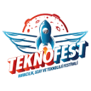

### Hi, I'm Batuhan 👋

**Full Stack Engineer · React Native · AI-Powered Applications**

I build web and mobile products end to end with TypeScript: React and Next.js on the web, React Native (Expo) on mobile, Node.js on the backend. Lately most of my work is **bringing LLMs and computer vision into real products**: AI service integrations, prompt design and structured outputs, image processing and model training pipelines.

Most of my production work lives in private repositories. What you see here are side projects and experiments.

- 📱 **8 apps shipped** to the App Store, from product design through release
- 🎓 Built a campus meal platform that served **2,000+ active students** and **560K+ page views** over two years

#### Achievements

&nbsp; **TEKNOFEST 2025**: Blockchain Competition finalist 
&nbsp; **Anadolu Group Bi'Fikir**: finalist (project matched with Migros) 
🥈&nbsp; **Hackathon**: runner-up (2024)

#### Experience

&nbsp; **Optade**: Full Stack Developer (current) 
&nbsp; **Jotform**: React Developer, App Builder team 
&nbsp; **Aras Kargo**: React Developer

---

#### AI Engineering

These days I'm mostly building AI-native products. Here's what I work on:

**🖥️ AI Product Engineering** 
Next.js admin panels with AI chat, reports, charts, notifications and action approvals. I own the product experience from start to finish.

**🧠 Applied AI Engineering** 
Getting LLMs to use company data correctly. I work with RAG pipelines, embeddings, structured outputs and AI-driven data analysis and reporting, and I measure how accurate the AI results are.

**🤖 AI Agent Engineering** 
Agents that use API tools: they request the data they need, plan multi-step tasks, talk to other systems and take actions only after human approval.

---

#### Tech Stack

| | |
|---|---|
| **AI / ML** |          |
| **Languages** |     |
| **Frontend** |       |
| **Mobile** |    |
| **Backend & Data** |       |
| **Tooling** |    |

---

#### Selected Work

| Project | What it is | Stack |
|---|---|---|
| **AI Visa Guide** · App Store | Checks visa requirements for 190+ countries and generates personalized, AI-backed document checklists | React Native · TypeScript · Gemini API |
| [**KYK & Campus Meals**](https://github.com/batuhansalkim/kyk_yemek_kahvalti) · [live](https://kyk-yemek-kahvalti.vercel.app) | Daily meal menus for dorm and campus students. 2,000+ active users, 560K+ page views | React · Firebase |
| [**Dijital Bahçem**](https://github.com/batuhansalkim/DijitalBahcemTekno) | TEKNOFEST 2025 finalist. Mobile app combining maps, BLE/NFC device pairing and on-chain records via a Web3 wallet | React Native · Expo · ethers.js · WalletConnect |
| [**SplitBill**](https://github.com/batuhansalkim/SplitBill) | Restaurant app with QR-based ordering, bill splitting and real-time order tracking | React Native · Expo · TypeScript · Zustand |
| [**Galaksi Kaşifi**](https://github.com/batuhansalkim/galaksi-kasifi) | Physics-based mobile game rendered with Skia | React Native · Skia · Matter.js |
| [**Law Notes Platform**](https://github.com/batuhansalkim/law-notes-platform) | Open platform where law students share and read course notes (PDF viewer, auth) | Next.js · Prisma · NextAuth |

Other iOS apps I've shipped include **SplitEasy**, **MathPulse**, **Fibo** and **RingLock**.

---

#### Writing

I write on [Medium](https://medium.com/@batuhansalkimm) (in Turkish) about APIs, system design, scalability and AI agents.

- [Yapay Çalışan Dönemi: API mi, Bordrolu Agent mı?](https://medium.com/@batuhansalkimm/yapay-%C3%A7al%C4%B1%C5%9Fan-d%C3%B6nemi-api-mi-bordrolu-agent-m%C4%B1-eec51ab3fef5)
- [Clawdbot: Açık Kaynak Kişisel AI Asistanı Devrimi](https://medium.com/@batuhansalkimm/clawdbot-a%C3%A7%C4%B1k-kaynak-ki%C5%9Fisel-ai-asistan%C4%B1-devrimi-sirinin-olmas%C4%B1-gereken-%C5%9Fey-sonunda-burada-283a5d4818de)
- [Aynı Anda 10.000 Kişi API'ye İstek Atarsa Ne Olur?](https://medium.com/@batuhansalkimm/ayn%C4%B1-anda-10-000-ki%C5%9Fi-apiye-i%CC%87stek-atarsa-ne-olur-abfa84e615b5)
- [100 Kullanıcıda Sorunsuz Çalışan Uygulamanıza Yarın 10.000 Kişi Gelirse Ne Olur?](https://medium.com/@batuhansalkimm/100-kullan%C4%B1c%C4%B1da-sorunsuz-%C3%A7al%C4%B1%C5%9Fan-uygulaman%C4%B1za-yar%C4%B1n-10-000-ki%C5%9Fi-gelirse-ne-olur-3ef9c2d0da9e)

---

  
  
  

Open to interesting problems and collaborations.
